# Trabajo Práctico N°4

*BD, SQL y Manejo de Versiones*

**Integrantes:** Delfina Cohen, Josefina Perez, Julian Haziel Granados Garcia

**Materia:** Informática Médica — ITBA

---

## Parte 1: Bases de Datos

### Base de datos centro médico

Se desea diseñar una base de datos relacional que almacene la información sobre los pacientes, médicos, recetas y consultas en un centro de salud. En la actualidad, la gestión de esta información se lleva a cabo del siguiente modo:

Cuando una persona acude al centro de salud, se le toma nota en una ficha con sus datos personales: nombre, fecha de nacimiento, sexo biológico y dirección (calle, número y ciudad). Esta ficha queda registrada en el archivo de pacientes del centro. Los médicos del centro también tienen su ficha, donde se registran su nombre completo, especialidad y dirección profesional.

Cada vez que un médico realiza una consulta o tratamiento a un paciente, puede emitir una receta. Esta receta incluye la fecha, el nombre del paciente atendido, el médico que la emite, el medicamento o tratamiento indicado, y la enfermedad o condición que motivó la prescripción. Esta información queda registrada y organizada para facilitar tanto el seguimiento del paciente como las auditorías clínicas.

Los tratamientos pueden incluir medicamentos, indicaciones como reposo o fisioterapia, y suelen tener especificaciones temporales (por ejemplo, “tomar por 5 días” o “uso indefinido”). También se registran enfermedades o diagnósticos asociados, permitiendo análisis estadísticos o seguimiento epidemiológico.

El sistema busca reemplazar los registros en papel por una solución digital que permita realizar búsquedas rápidas, obtener estadísticas de distribución demográfica, sexo y especialidad, y mantener la información organizada para su integración con otros módulos médicos como historiales clínicos, turnos o recetas médicas.

### Consignas

1. ¿Qué tipo de base de datos es? Clasificarla según su propósito.

Es una base de datos relacional transaccional, ya que permite gestionar y actualizar la información generada diariamente en un centro médico. Además, posee una finalidad analítica secundaria, porque facilita la elaboración de estadísticas sobre pacientes, diagnósticos y especialidades. Se utiliza un modelo relacional para organizar los datos en tablas vinculadas mediante claves.

2. Planteando el Modelo conceptual, armar el diagrama entidad-relación de la base de datos dada. (Usar notación de Chen, marcando tipo de participación, cardinalidad, claves primarias y parciales).

Guiándonos del ejemplo del apunte, primero identificamos entidades y atributos:

1. **Paciente - entidad fuerte**

   1. ID_Paciente: clave primaria (PK).

   2. Nombre.

   3. Fecha_nacimiento.

   4. Sexo_biológico.

   5. Dirección: atributo compuesto por Calle, Número y Ciudad.

2. **Médico - entidad fuerte**

   1. ID_Medico: PK.

   2. Nombre_completo.

   3. Especialidad.

   4. Dirección_profesional.

3. **Consulta - entidad fuerte**

   1. ID_Consulta: PK.

   2. Fecha_consulta (propuesta para registrar el evento).

4. **Receta** — entidad débil, porque depende de la consulta

   1. Nro_Receta: clave parcial.

   2. Fecha_emision.

5. **Tratamiento - entidad fuerte**

   1. ID_Tratamiento: PK.

   2. Nombre_tratamiento.

   3. Tipo_tratamiento (medicamento, reposo, fisioterapia, etc.).

6. **Diagnóstico - entidad fuerte**

   1. ID_Diagnostico: PK.

   2. Nombre_diagnostico.

Luego, identificamos las relaciones:

1. **Realiza**

   1. cardinalidad: 1:N

      1. Un paciente puede realizar muchas consultas

   2. participación: paciente parcial, consulta total

      1. Un paciente puede estar registrado sin haber tenido ninguna consulta: participación parcial.

      2. Una consulta necesariamente debe pertenecer a un paciente: participación total.

2. **Atiende**

   1. Participación: médico parcial, consulta total

      1. Mismos motivos que en “realiza”

   2. cardinalidad: 1:N

      1. Un médico puede atender muchas consultas

3. **Emite**

   1. Participación: consulta parcial, receta total

      1. Una consulta puede existir sin receta, pero una receta no puede existir sin consulta

   2. Cardinalidad: 1:N

      1. Cada receta pertenece a una única consulta

4. **Indica**

   1. participación: Receta total, Tratamiento parcial

      1. Toda receta debe indicar al menos un tratamiento

      2. Un tratamiento puede estar registrado sin haber sido indicado todavía

   2. cardinalidad: M:N

      1. Una receta puede indicar varios tratamientos y varios tratamientos pueden aparecer en varias recetas

      2. La relación *Indica* tendrá el atributo **Duración**, porque describe cómo se prescribe ese tratamiento en esa receta.

5. **Motivada**

   1. participación: receta total, diagnóstico parcial

      1. Toda receta tiene un diagnóstico asociado: participación total.

      2. Un diagnóstico puede existir en el catálogo sin estar asociado a ninguna receta: participación parcial.

   2. Cardinalidad: N:1

      1. Cada receta se asocia con un diagnóstico.

      2. Un diagnóstico puede motivar muchas recetas.

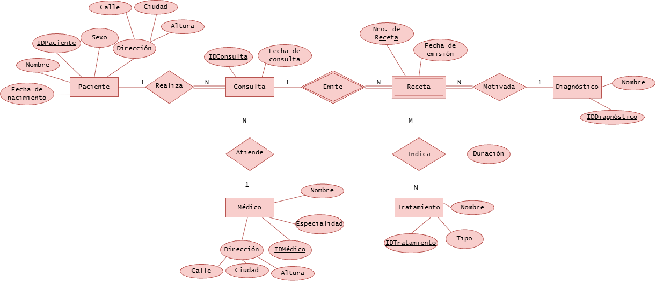

3. Mapear del Modelo conceptual planteado en el punto 2 al Modelo Relacional de la base de datos dada. (Usar notación Crow’s foot en el diagrama, indicando cardinalidad mínima y máxima).

Primero se realizó el mapeo de entidades

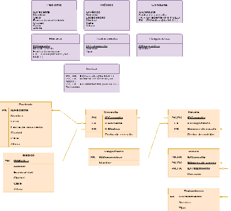

Se incluye el mapeo de relaciones, agregando la séptima tabla **Indica** porque como hay una relación M:N, se forman claves foráneas entre IDConsulta y Número de receta, que referencian a Receta, y IDTratamiento que referencia a Tratamiento y Duración que indica la prolongación del tratamiento indicado.

**Diagrama de tablas**

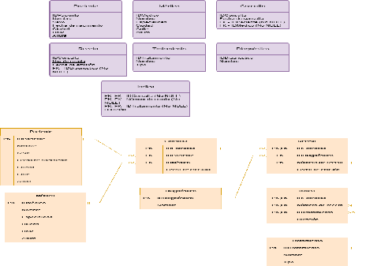

4. Indicar qué forma normal se viola en los siguientes casos y justificar: **Caso 1:**

| PacienteInfo |  |  |
| ----- | ----- | ----- |
| **PacienteID(Pk)**  | **Nombre**  | **Teléfonos** |
| 1  | Ana  | 1111, 2222 |
| 2  | Juan  | 3333 |

Viola la **primera forma normal,** ya que esta establece que cada celda debe contener un único valor atómico.

En este caso, el atributo teléfonos contiene dos valores en la misma celda, siendo un atributo multivaluado que no cumple con la atomicidad exigida por la primera forma normal.

**Caso 2:**

| PacienteInfo |  |  |
| ----- | ----- | ----- |
| **PacienteID(Pk)**  | **Ciudad**  | **CódigoPostal** |
| 1  | CABA  | 1000 |
| 2  | La Plata  | 1900 |

Viola la **tercera forma normal** ya que la tercera forma normal establece que los atributos que no son claves deben depender directamente de la clave primaria y no de otros atributos no clave. En este caso hay una dependencia transitiva porque Ciudad depende de PacienteID, pero Código Postal depende de Ciudad.

**Caso 3:**

| AtencionPacienteMedico |  |  |  |
| ----- | ----- | ----- | ----- |
| **PacienteID(Pk)**  | **MédicoID(Pk)**  | **NombrePaciente**  | **Especialidad** |
| 1  | 10  | Ana  | Pediatría |
| 2  | 20  | Juan  | Cardiología |

Este caso viola la **segunda forma normal** que establece que todos los atributos no clave deben depender de la clave primaria completa, no solamente de una parte. En este caso la clave primaria es compuesta (PacienteID, MédicoID), pero Nombre del Paciente depende solo de PacienteID y Especialidad depende de MédicoID. No es necesario conocer la clave completa para determinar su valor.

**Caso 4:**

| ConsultasPaciente |  |  |
| ----- | ----- | ----- |
| **PacienteID**  | **Enfermedad**  | **Medicamento** |
| 1  | Gripe  | Paracetamol |
| 1  | Gripe  | Ibuprofeno |
| 1  | Diabetes  | Paracetamol |
| 1  | Diabetes  | Ibuprofeno |

Viola la **cuarta forma normal** que establece que no deben existir dependencias multivaluadas independientes dentro de una misma tabla, salvo que estén determinadas por una superclave.
En este caso vemos que un mismo paciente puede tener varias enfermedades y varios medicamentos, y suponiendo que ambas listas son independientes, se generan todas las combinaciones posibles entre estos dos
Esto genera redundancia porque repetimos las enfermedades para cada medicamento y los medicamentos para cada enfermedad.


No se considerarán válidos aquellos trabajos que consistan simplemente en generar un diagrama entidad-relación y/o modelo relacional automáticamente a partir del script SQL dado.

Se espera que el modelo propuesto:

- Surja del análisis del enunciado y los requerimientos del sistema.

- Incluya decisiones de diseño fundamentadas.

- Aplique criterios de normalización, de ser posible.

- Incorpore, cuando corresponda, tablas de referencia (por ejemplo, para especialidades, etc.).

- Busque evitar problemas típicos como redundancia, inconsistencias o dificultades de mantenimiento.

---

## Parte 2: SQL

Para esta sección, utilizar la base de datos implementada en el archivo “base_de_datos.sql” subido a Campus. Para realizar las consultas se pueden utilizar herramienta online para ejecutar SQL en el navegador como: https://sqliteonline.com/

### Consignas

1. Cuando se realizan consultas sobre la tabla paciente agrupando por ciudad los tiempos de respuesta son demasiado largos. Proponer mediante una query SQL una solución a este problema.

Para mejorar los tiempos de respuesta cuando se agrupa por ciudad hace falta crear un índice sobre la columna ciudad de la tabla pacientes para mejorar la performance, ya que al indexar el campo, se guarda aparte una lista ordenada con los valores a la que se puede acceder de manera más rápida y eficiente (no hace falta ir buscando fila por fila).

```sql
CREATE INDEX idx_pacientes_ciudad
ON Pacientes (ciudad);
```

Para ver el nuevo índice:

```sql
SELECT indexname, indexdef
FROM pg_indexes
WHERE schemaname = 'public' AND tablename = 'pacientes';
```

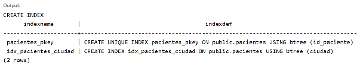

2. Se tiene la fecha de nacimiento de los pacientes. Se desea calcular la edad de los pacientes y almacenarla de forma dinámica en el sistema ya que es un valor típicamente consultado, junto con otra información relevante del paciente.

Se crea una vista que calcula la edad a partir de la fecha de nacimiento y la fecha actual, usando EXTRACT(YEAR FROM AGE(CURRENT_DATE, fecha_nacimiento)), con YEAR nos quedamos solo con los años que serían la edad de la persona. Como la vista no guarda la edad sino la consulta, el valor se recalcula cada vez que se consulta y siempre está actualizado, sin tener que modificar la tabla (esto significa que es dinámico). Además de la edad, incluye otros datos relevantes del paciente: nombre, fecha de nacimiento, sexo y dirección.

Para traer el sexo como texto (en lugar del id_sexo) se usa un INNER JOIN con SexoBiologico. Es el join adecuado porque muestra la información de los pacientes que tienen información en ambas tablas (la intersección). No usamos FULL OUTER JOIN porque no queremos tener NULL en la vista y no sabemos si todos los pacientes que estan en la tabla SexoBiologico estan tambien en la tabla de Pacientes, por lo que INNER JOIN es más adecuado.

```sql
CREATE VIEW vista_pacientes AS
SELECT
    p.id_paciente,
    p.nombre,
    p.fecha_nacimiento,
    EXTRACT(YEAR FROM AGE(CURRENT_DATE, p.fecha_nacimiento)) AS edad,
    s.descripcion AS sexo,
    p.calle,
    p.numero,
    p.ciudad
FROM Pacientes p
JOIN SexoBiologico s ON s.id_sexo = p.id_sexo;
```

```sql
select * from vista_pacientes;
```

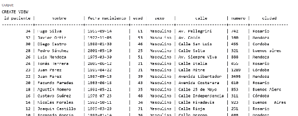

3. Obtener nombre y edad de pacientes menores de edad.

```sql
SELECT
    nombre,
    EXTRACT(YEAR FROM AGE(CURRENT_DATE, fecha_nacimiento)) AS edad
FROM Pacientes
WHERE AGE(CURRENT_DATE, fecha_nacimiento) < INTERVAL '18 years';
```

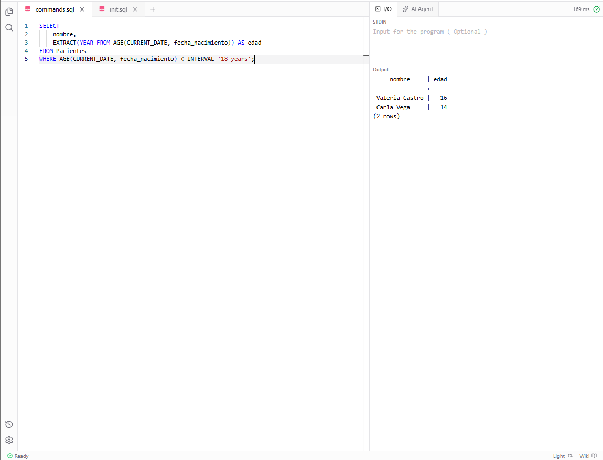

4. La paciente, “Luciana Gómez”, ha cambiado de dirección. Antes vivía en “Avenida Las Heras 121” en “Buenos Aires”, pero ahora vive en “Calle Corrientes 500” en “Buenos Aires”. Actualizar la dirección de este paciente en la base de datos.

```sql
UPDATE Pacientes
SET
    calle = 'Calle Corrientes',
    numero = '500',
    ciudad = 'Buenos Aires'
WHERE nombre = 'Luciana Gómez'
  AND calle = 'Avenida Las Heras'
  AND numero = '121';
```

```sql
SELECT
  nombre,
  ciudad,
  calle,
  numero
FROM Pacientes;
```

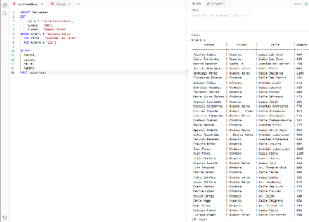

5. Obtener el nombre y la dirección de los pacientes que viven en Buenos Aires.

```sql
SELECT
    nombre,
    calle,
    numero,
    ciudad
FROM Pacientes
WHERE ciudad ilike'%B%Ai%';
```

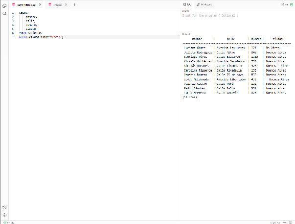

6. Puede pasar que haya inconsistencias en la forma en la que están escritos los nombres de las ciudades, ¿cómo se corrige esto? Agregar la query correspondiente.

```sql
UPDATE Pacientes
SET ciudad = CASE
    WHEN ciudad ilike'%B%Ai%'
        THEN 'Buenos Aires'
    WHEN ciudad ilike'%C%'
        THEN 'Córdoba'
    WHEN ciudad ilike'%Men%'
        THEN 'Mendoza'
    WHEN ciudad ilike'%Ros%'
        THEN 'Rosario'
    WHEN ciudad ilike'%San%'
        THEN 'Santa Fe'
END;
```

```sql
SELECT ciudad
FROM Pacientes;
```

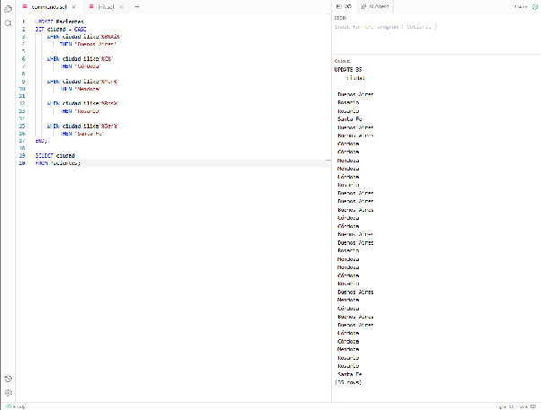

7. Cantidad de pacientes por sexo que viven en cada ciudad.

```sql
UPDATE Pacientes
SET ciudad = CASE
    WHEN ciudad ilike'%B%Ai%'
        THEN 'Buenos Aires'
    WHEN ciudad ilike'%C%'
        THEN 'Córdoba'
    WHEN ciudad ilike'%Men%'
        THEN 'Mendoza'
    WHEN ciudad ilike'%Ros%'
        THEN 'Rosario'
    WHEN ciudad ilike'%San%'
        THEN 'Santa Fe'
END;
/*
SELECT ciudad, id_sexo, COUNT(*) AS cantidad_pacientes
FROM Pacientes
GROUP BY ciudad, id_sexo
ORDER BY ciudad, cantidad_pacientes;
*/
SELECT
  p.ciudad,
  s.descripcion,
  COUNT(*) AS cantidad_pacientes
FROM Pacientes p
INNER JOIN SexoBiologico s
  ON p.id_sexo = s.id_sexo
GROUP BY p.ciudad, s.descripcion
ORDER BY p.ciudad, s.descripcion;
```

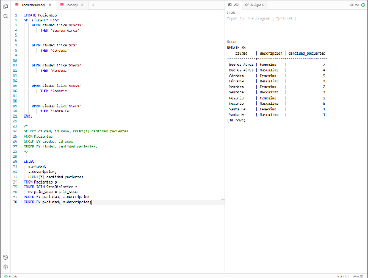

8. Obtener todas las consultas médicas realizadas por el médico con ID igual a 3 durante el mes de agosto de 2024.

```sql
SELECT *
FROM Consultas
WHERE id_medico = 3
  AND fecha >= DATE '2024-08-01'
  AND fecha < DATE '2024-09-01'
ORDER BY fecha;
```

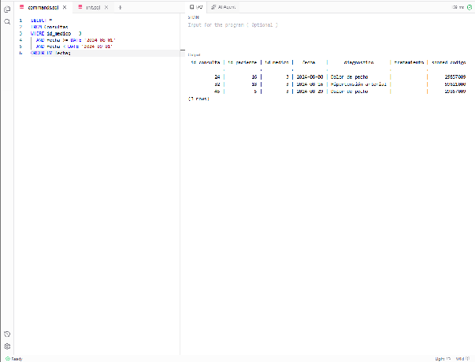

9. Obtener la cantidad de recetas emitidas por cada médico.

```sql
SELECT
    m.nombre AS medico,
    COUNT(r.id_receta) AS cantidad_recetas
FROM Medicos m
LEFT JOIN Recetas r
    ON m.id_medico = r.id_medico
GROUP BY m.id_medico, m.nombre
ORDER BY m.id_medico;
```

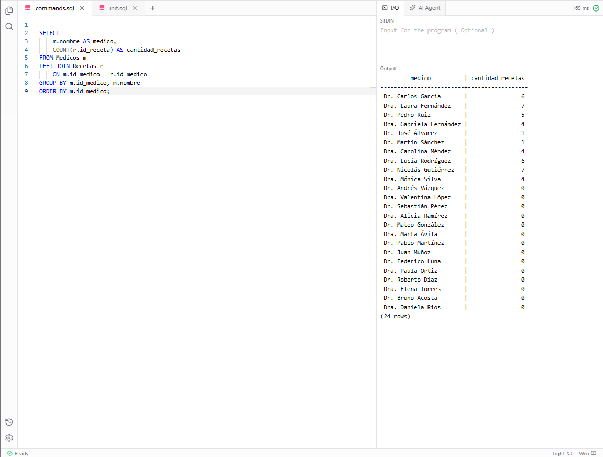

10. Obtener el nombre de los pacientes junto con la fecha y el diagnóstico de todas las consultas médicas realizadas en agosto del 2024.

```sql
SELECT
    p.nombre AS paciente,
    c.fecha,
    c.diagnostico
FROM Consultas c
INNER JOIN Pacientes p
    ON c.id_paciente = p.id_paciente
WHERE c.fecha >= DATE '2024-08-01'
  AND c.fecha < DATE '2024-09-01'
ORDER BY c.fecha;
```

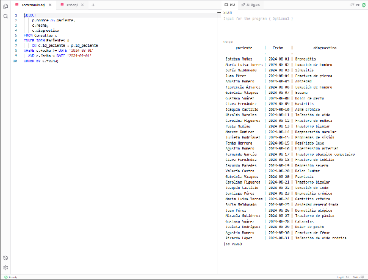

11. Obtener el nombre de los medicamentos prescritos más de una vez por el médico con ID igual a 2.

```sql
SELECT
    med.nombre AS medicamento,
    COUNT(*) AS veces_prescrito
FROM Recetas r
INNER JOIN Medicamentos med
    ON r.id_medicamento = med.id_medicamento
WHERE r.id_medico = 2
GROUP BY med.id_medicamento, med.nombre
HAVING COUNT(*) > 1
ORDER BY med.nombre;
```

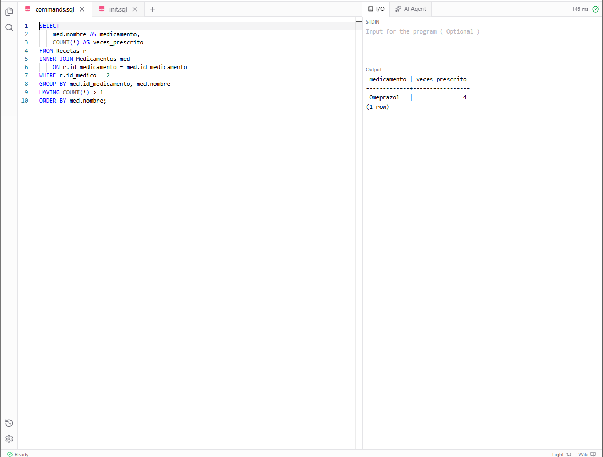

12. Obtener el nombre de cada paciente junto con la cantidad total de recetas que ha recibido.

```sql
SELECT
    p.nombre AS paciente,
    COUNT(r.id_receta) AS total_recetas
FROM Pacientes p
LEFT JOIN Recetas r
    ON p.id_paciente = r.id_paciente
GROUP BY p.id_paciente, p.nombre;
```

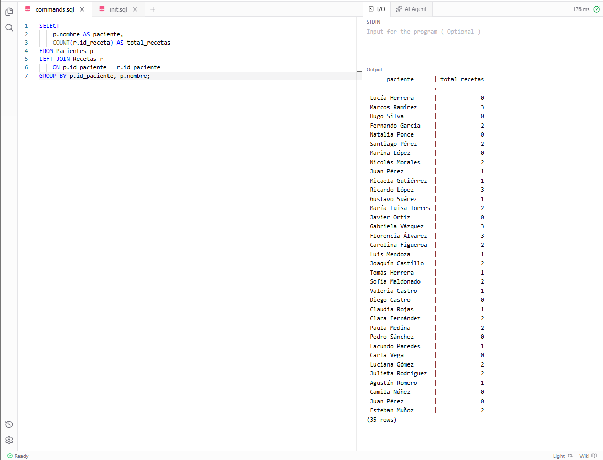

13. Obtener el nombre de cada especialidad y la cantidad de médicos que pertenecen a ella, mostrando únicamente aquellas especialidades que tienen más de 2 médicos.

```sql
SELECT
    e.nombre AS especialidad,
    COUNT(m.id_medico) AS cantidad_medicos
FROM Especialidades e
INNER JOIN Medicos m
    ON e.id_especialidad = m.especialidad_id
GROUP BY e.id_especialidad, e.nombre
HAVING COUNT(m.id_medico) > 2;
```

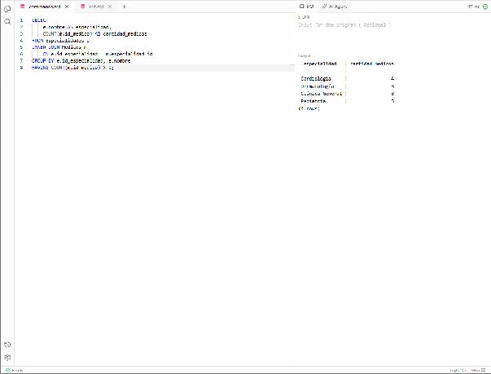

14. Obtener el nombre y la edad de los pacientes cuya edad sea mayor al promedio de edad de todos los pacientes, ordenados de mayor a menor edad.

```sql
WITH Edades AS (
    SELECT
        id_paciente,
        nombre,
        EXTRACT(
            YEAR FROM AGE(CURRENT_DATE, fecha_nacimiento)
        )::INT AS edad
    FROM Pacientes
)
SELECT
    nombre,
    edad
FROM Edades
WHERE edad > (
    SELECT AVG(edad)
    FROM Edades
)
ORDER BY edad DESC;
```

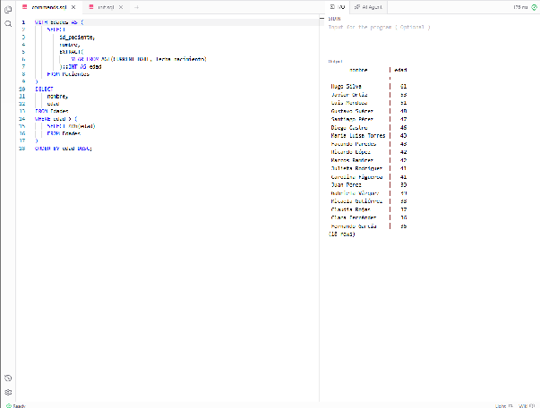

15. Obtener los medicamentos que ocupan las dos primeras posiciones en cantidad de recetas emitidas, indicando para cada uno la cantidad de recetas.

```sql
SELECT
    med.nombre AS medicamento,
    COUNT(r.id_receta) AS cantidad_recetas
FROM Medicamentos med
INNER JOIN Recetas r
    ON med.id_medicamento = r.id_medicamento
GROUP BY med.id_medicamento, med.nombre
ORDER BY cantidad_recetas DESC
LIMIT 2;
/*
WITH RankingMedicamentos AS (
    SELECT
        m.nombre AS medicamento,
        COUNT(r.id_receta) AS cantidad_recetas,
        RANK() OVER (
            ORDER BY COUNT(r.id_receta) DESC
        ) AS ranking
    FROM Medicamentos m
    INNER JOIN Recetas r
        ON m.id_medicamento = r.id_medicamento
    GROUP BY m.id_medicamento, m.nombre
)
SELECT
    medicamento,
    cantidad_recetas,
    ranking
FROM RankingMedicamentos
WHERE ranking <= 2
ORDER BY ranking, medicamento;
*/
```

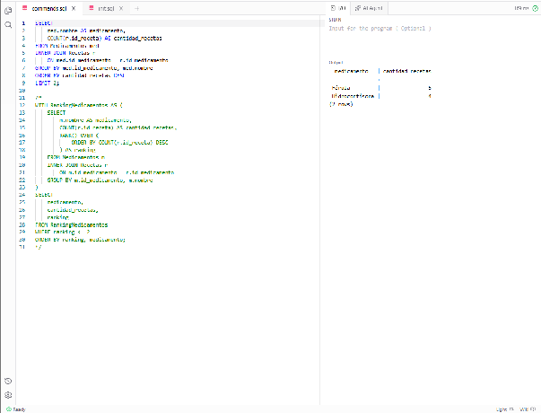

16. Obtener el nombre del paciente junto con la fecha de su última consulta y el diagnóstico asociado.

```sql
WITH ultima_consulta AS (
    SELECT id_paciente, MAX(fecha) AS fecha_ultima
    FROM Consultas
    GROUP BY id_paciente
)
SELECT p.nombre,
       c.fecha AS fecha_ultima_consulta,
       c.diagnostico
FROM Pacientes p
JOIN ultima_consulta u ON u.id_paciente = p.id_paciente
JOIN Consultas c ON c.id_paciente = u.id_paciente
                AND c.fecha = u.fecha_ultima
ORDER BY p.nombre;
```

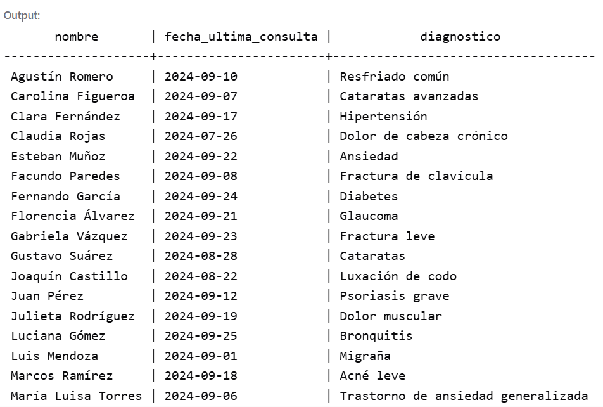

17. Obtener el nombre del médico junto con el nombre del paciente y el número total de consultas realizadas por cada médico para cada paciente, ordenado por médico y paciente.

```sql
SELECT m.nombre AS medico,
       p.nombre AS paciente,
       COUNT(*) AS total_consultas
FROM Consultas c
JOIN Medicos m ON m.id_medico = c.id_medico
JOIN Pacientes p ON p.id_paciente = c.id_paciente
GROUP BY m.id_medico, m.nombre, p.id_paciente, p.nombre
ORDER BY m.nombre, p.nombre;
```

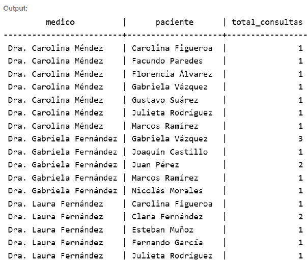

Usamos INNER JOIN porque podría pasar que un médico no haya participado de ninguna consulta y sino nos traería el nombre del médico y lo demás NULL. Con consultas podríamos usar LEFT o RIGHT JOIN y traer todo de consultas (porque no existe consulta sin médico y sin paciente) pero como es lo mismo preferimos usar el INNER JOIN y asegurarnos que está ok. Respecto del GROUP BY es necesario agrupar también por id porque podría haber dos personas con el mismo nombre y apellido pero que sean pacientes distintos (y ahí tienen ids distintos).

18. Obtener el nombre del medicamento junto con el total de recetas prescritas para ese medicamento, el nombre del médico que lo recetó y el nombre del paciente al que se le recetó, ordenado por total de recetas en orden descendente.

```sql
WITH total_por_medicamento AS (
    SELECT id_medicamento, COUNT(*) AS total_recetas
    FROM Recetas
    GROUP BY id_medicamento
)
SELECT med.nombre AS medicamento,
       t.total_recetas,
       m.nombre AS medico,
       p.nombre AS paciente
FROM Recetas r
JOIN Medicamentos med ON med.id_medicamento = r.id_medicamento
JOIN total_por_medicamento t ON t.id_medicamento = r.id_medicamento
JOIN Medicos m ON m.id_medico = r.id_medico
JOIN Pacientes p ON p.id_paciente = r.id_paciente
ORDER BY t.total_recetas DESC, med.nombre, m.nombre, p.nombre;
```

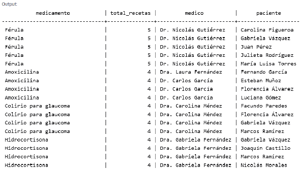

19. Obtener el nombre del médico junto con el total de pacientes a los que ha atendido, ordenado por el total de pacientes en orden descendente.

```sql
SELECT
    m.nombre AS medico,
    COUNT(DISTINCT c.id_paciente) AS total_pacientes
FROM Medicos m
LEFT JOIN Consultas c
    ON m.id_medico = c.id_medico
GROUP BY m.id_medico, m.nombre
ORDER BY total_pacientes DESC;
```

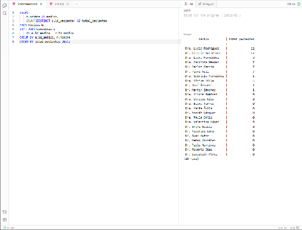

20. Obtener el nombre de cada médico junto con el número total de consultas realizadas por cada uno a pacientes menores de edad y una tercera columna que indique si el médico es pediatra (TRUE/FALSE).

```sql
SELECT m.nombre AS medico,
       COUNT(p.id_paciente) AS consultas_menores,
       CASE WHEN e.nombre = 'Pediatría' THEN TRUE ELSE FALSE END AS es_pediatra
FROM Medicos m
LEFT JOIN Especialidades e ON e.id_especialidad = m.especialidad_id
LEFT JOIN Consultas c ON c.id_medico = m.id_medico
LEFT JOIN Pacientes p ON p.id_paciente = c.id_paciente
                     AND EXTRACT(YEAR FROM AGE(CURRENT_DATE, p.fecha_nacimiento)) < 18
GROUP BY m.id_medico, m.nombre, e.nombre
ORDER BY consultas_menores DESC, m.nombre;
```

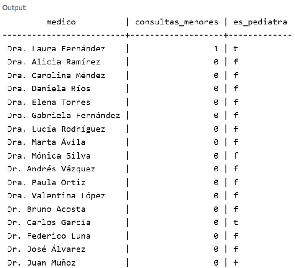

---
